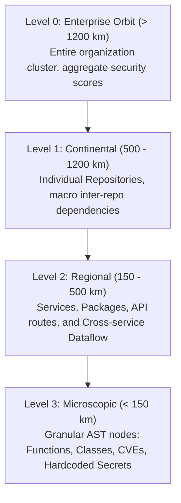

<!--
=====================================================================
Author: Mauro Risonho de Paula Assumpção
Create: 2026-10-18
Update: 2026-10-23
Short Description: OSAKG project overview, architecture, quickstart guide, and feature walkthrough
License: MIT
=====================================================================
-->

# OSAKG — Offensive Security Adversarial Knowledge Graph

<p align="center">
  
  
  
  
  
  
  
</p>

An ethical, authorized, local-first, multi-repository offensive-security knowledge graph designed for deep code intelligence, cross-repository dataflow analysis, attack-surface discovery, AI red teaming, and interactive **Google-Earth-like 3D semantic exploration**.

OSAKG bridges the semantic gap between high-level organizational structure (organizations, teams, repositories) and microscopic code artifacts (functions, classes, AST nodes, CVEs, secrets, and API routes), enabling security engineers to trace tactical attack paths across multi-repo environments in real time.

---

## 🌟 Key Highlights

- **Continuous 3D Semantic Zoom (Google-Earth Paradigm)**:
  Fly seamlessly from **Orbit (L0: Enterprise/Org)** down into **Continental (L1: Repositories)**, **Regional (L2: Services & Packages)**, and **Street/Microscopic (L3: AST Functions, Classes, & Vulnerabilities)** with altitude-driven level-of-detail (LOD) and dynamic billboard labels.
- **Anthropic Organization Ingestion**:
  Includes full real-world ingestion of **100 repositories** from the `anthropics` public organization, parsed into **1,603 nodes**, **1,700 edges**, and **1,471 granular AST entities** with deterministic SHA-256 IDs and full provenance metadata.
- **Tactical Attack Paths & Kill Chain Engine**:
  Computes cross-repository Dijkstra/A* shortest attack vectors. Graphically traces multi-stage kill chains (e.g., Unauthenticated Prompt Injection $\to$ Tool Execution $\to$ Hardcoded Token Leak $\to$ S3 Exfiltration) with CVSS 9.8 scoring, neon overlay beams, and animated directional particles.
- **Corporate Enterprise UI**:
  - **Enterprise HUD**: Live node/edge telemetry, camera altitude in km, active scope badge, and attack path status indicator.
  - **Command Palette (`Ctrl+K` / `Cmd+K`)**: Rapid spotlight search filtering across repositories, services, AST symbols, and CVEs with instant camera fly-to.
  - **Light/Dark Theme & Color Customizer (`T` / `C`)**: High-contrast corporate dark mode, clean light mode, and 5 curated enterprise themes (*Cyber Obsidian, Cobalt Security, Slate Minimal, Emerald Guard, Crimson Breach*) plus custom RGB/HSL customization.
  - **Slide-over Inspector Drawer**: 4 dedicated tabs (*Overview, Security & CVSS, Evidence & Provenance, Graph Relations*).
- **Security-First Architecture**:
  Engineered in **Rust** (10 audited workspace crates) for memory safety and zero-cost abstractions, bundled in **Tauri 2** for lightweight native cross-platform binaries (Linux, macOS, Windows).
- **Evidence-Driven Provenance**:
  Adheres strictly to the core invariant: **a graph connection is not proof of exploitability**. Distinguishes between *observed*, *inferred*, *validated*, and *refuted* claims with confidence metrics.

---

## 🏗️ System Architecture

OSAKG follows a decoupled, modular, local-first architecture:

```mermaid
flowchart TD
    subgraph Data Sources & Ingestion
        GH[GitHub / Git Clones] --> Ingest[crates/osakg-ingest]
        Pkg[Cargo / NPM / PyPI Manifests] --> Ingest
        AST[Tree-Sitter Parsers] --> CodeGraph[crates/osakg-codegraph]
        Scan[Semgrep / Gitleaks / Trivy] --> Adapters[crates/osakg-adapters]
    end

    subgraph Core Graph Engine [Rust Workspace]
        Ingest --> Fusion[crates/osakg-fusion]
        CodeGraph --> Fusion
        Adapters --> Fusion
        Fusion --> Graph[crates/osakg-graph (Petgraph + FalkorDB)]
        Evidence[crates/osakg-evidence (SQLite Ledger)] <--> Graph
        Graph --> AttackPath[crates/osakg-attackpath]
        Graph --> AIRedTeam[crates/osakg-ai-redteam]
        Graph --> API[crates/osakg-api (Axum REST & WebSocket)]
    end

    subgraph Client Applications
        API <--> Desktop[apps/desktop (Tauri 2 Runtime)]
        API <--> Web[apps/web (React 18 + Three.js)]
        Desktop --- Web
    end
```

### Workspace Crates

| Crate | Description |
|---|---|
| [`osakg-core`](file:///home/test/Downloads/Github/Grafos/crates/osakg-core) | Core domain types, node/edge models, scopes, deterministic SHA-256 IDs, and DTOs |
| [`osakg-graph`](file:///home/test/Downloads/Github/Grafos/crates/osakg-graph) | High-performance in-memory and persistent graph storage with spatial indexing |
| [`osakg-ingest`](file:///home/test/Downloads/Github/Grafos/crates/osakg-ingest) | Repository walkers, package manifest parsers, and batch ingestion workers |
| [`osakg-codegraph`](file:///home/test/Downloads/Github/Grafos/crates/osakg-codegraph) | Tree-sitter AST symbol extractors, function call graphs, and language analyzers |
| [`osakg-adapters`](file:///home/test/Downloads/Github/Grafos/crates/osakg-adapters) | Parsers and normalizers for external scanners (Semgrep, Gitleaks, Trivy, OSV) |
| [`osakg-fusion`](file:///home/test/Downloads/Github/Grafos/crates/osakg-fusion) | Entity resolution, disjoint-set deduplication, and cross-repo heuristic fusion |
| [`osakg-evidence`](file:///home/test/Downloads/Github/Grafos/crates/osakg-evidence) | Cryptographic provenance vault and SQLite evidence verification ledger |
| [`osakg-attackpath`](file:///home/test/Downloads/Github/Grafos/crates/osakg-attackpath) | Graph traversal, risk propagation evaluator, and Dijkstra/A* kill chain finder |
| [`osakg-ai-redteam`](file:///home/test/Downloads/Github/Grafos/crates/osakg-ai-redteam) | Guardrailed AI red team simulation engine and threat hypothesis validator |
| [`osakg-api`](file:///home/test/Downloads/Github/Grafos/crates/osakg-api) | Axum REST router, WebSocket real-time telemetry streaming, and CLI daemon |

---

## 🔭 3D Semantic Zoom Hierarchy

The 3D visualization implements continuous Google-Earth semantic zoom with 4 distinct altitude tiers:



- **LOD Culling & Frustum Optimization**: High-frequency AST nodes and internal call edges dynamically fade out as camera ascends to maintain solid 60 FPS performance even on datasets with thousands of nodes.
- **Tactical Attack Path Mode**: Pressing `[P]` or clicking the Tactical Attack Path toggle isolates critical attack vectors, dimming unrelated infrastructure and highlighting attack edges with high-intensity neon colors and animated energy pulses.

---

## ⌨️ Keyboard & UI Controls

| Key / Control | Action |
|---|---|
| <kbd>Ctrl</kbd> + <kbd>K</kbd> / <kbd>Cmd</kbd> + <kbd>K</kbd> | Open Spotlight **Command Palette** for fuzzy search |
| <kbd>T</kbd> | Toggle **Dark / Light** corporate theme |
| <kbd>C</kbd> | Open **Enterprise Color Customizer** modal |
| <kbd>P</kbd> | Toggle **Tactical Attack Path (Kill Chain)** overlay |
| <kbd>1</kbd> / <kbd>2</kbd> / <kbd>3</kbd> / <kbd>4</kbd> | Fly camera directly to zoom levels (**L0, L1, L2, L3**) |
| <kbd>Space</kbd> | Reset camera orientation and center graph |
| <kbd>Esc</kbd> | Close slide-over drawer, modals, or deselect node |
| **Mouse Left-Click** | Select node to inspect details, CVEs, and provenance |
| **Mouse Left-Drag** | Orbit / rotate 3D camera |
| **Mouse Right-Drag** | Pan 3D camera |
| **Mouse Scroll** | Continuous altitude zoom in / out |

---

## 🚀 Quickstart & Execution

### Prerequisites

- **Rust** 1.75+ (`rustup default stable`)
- **Node.js** 18+ and **npm** 9+
- *(Optional for Desktop packaging)* Platform build tools (GTK3 / WebKit2GTK on Linux, Xcode CLI on macOS)

### 1. Using the Orchestration Makefile

The repository includes a comprehensive [`Makefile`](file:///home/test/Downloads/Github/Grafos/Makefile):

```bash
# Display full help menu of all available targets
make help

# Run complete verification suite (fmt, clippy, unit tests, tsc, vite build)
make check

# Run all backend and frontend tests
make test

# Start the interactive 3D Web visualization client
make dev-web

# Start the standalone backend REST API server (Axum)
make dev-server

# Launch the native Tauri 2 desktop application
make dev-desktop

# Compile production binaries for backend and frontend
make build
```

### 2. Manual Execution

#### Run Verification Suite
```bash
./scripts/check.sh
```

#### Launch 3D Web Visualizer
```bash
cd apps/web
npm install
npm run dev
```
Open [http://localhost:5173](http://localhost:5173). The visualizer runs offline with synthetic fixtures or loads the ingested Anthropic universe (`public/anthropics_universe.json`).

#### Launch Axum REST API Server
```bash
cargo run --bin osakg-server
```
Starts at `http://127.0.0.1:3030`. Health check:
```bash
curl http://127.0.0.1:3030/health
```

#### Ingest Public GitHub Repositories
To re-crawl or update repositories from a GitHub organization:
```bash
python3 scripts/ingest_anthropic.py
python3 scripts/generate_deep_universe.py
```

---

## 🛡️ Security & Defensive Operating Boundaries

OSAKG is an authorized defensive research platform adhering to strict safety invariants:

1. **Passive Analysis by Default**: No active network probing, live vulnerability exploitation, credential brute-forcing, or stealth evasion.
2. **Local-First & Data Privacy**: Source code, ASTs, and discovered findings remain strictly local. No source fragments or API tokens are sent to external LLM services without explicit user opt-in and redaction.
3. **Evidence & Provenance Mandatory**: Every vulnerability claim or attack path edge must carry provenance metadata (`source`, `confidence`, `claim_type`). A structural dependency is never reported as an exploit without validated preconditions.
4. **Gated Dynamic Validation**: Dynamic simulations and AI red teaming must be explicitly authorized and executed solely against local synthetic testbeds or allowlisted sandbox environments.

For complete vulnerability reporting and security policies, see [`SECURITY.md`](file:///home/test/Downloads/Github/Grafos/SECURITY.md).

---

## 📊 Graph Schema Overview

OSAKG structures multi-repo code intelligence into standardized hierarchical entities:

- **Scopes**:
  - `Enterprise` $\to$ `Organization` $\to$ `Repository` $\to$ `Package` $\to$ `Service` $\to$ `Module` $\to$ `AstEntity`
- **Node Types**:
  - `Repository`, `Package`, `Service`, `ApiEndpoint`, `AstFunction`, `AstClass`, `FindingVulnerability`, `FindingSecret`, `AttackStep`
- **Edge Types**:
  - `Contains`: Structural containment (Repo contains File, File contains Function)
  - `Imports` / `Calls`: Code-level dependency or invocation
  - `ExposesEndpoint`: Service provides a network or API interface
  - `ConsumesEndpoint`: Client makes network call to remote endpoint
  - `Exploits` / `Traverses`: Attack step leverages a vulnerability to compromise next asset
  - `HasFinding`: Associates vulnerability or secret finding to a code symbol

For detailed JSON schemas and Cypher examples, see [`GRAPH_SCHEMA.md`](file:///home/test/Downloads/Github/Grafos/GRAPH_SCHEMA.md).

---

## 📁 Repository Structure

```
├── Makefile                    # Orchestration tasks and commands
├── Cargo.toml                  # Workspace manifest defining 10 crates
├── package.json                # Root package configuration
├── scripts/
│   ├── check.sh                # End-to-end lint, test, and build suite
│   ├── ingest_anthropic.py     # GitHub API crawler for Anthropic org
│   ├── generate_deep_universe.py # AST generator & attack path builder
│   └── add_headers.py          # Standardized header automation
├── apps/
│   ├── web/                    # React 18 + Three.js 3D visualizer
│   │   ├── src/components/     # Universe3D, EnterpriseHeader, NodeDrawer, CommandPalette
│   │   └── public/             # Ingested Anthropic 3D graph dataset
│   └── desktop/                # Tauri 2 native desktop application wrapper
├── crates/                     # 10 Rust backend crates
│   ├── osakg-core/             # Graph models, DTOs, SHA-256 IDs
│   ├── osakg-graph/            # In-memory graph and query engine
│   ├── osakg-ingest/           # Repository ingestion pipeline
│   ├── osakg-codegraph/        # Tree-sitter AST intelligence
│   ├── osakg-adapters/         # Scanner normalizers
│   ├── osakg-fusion/           # Entity resolution & cross-repo fusion
│   ├── osakg-evidence/         # SQLite provenance ledger
│   ├── osakg-attackpath/       # Kill chain & risk evaluator
│   ├── osakg-ai-redteam/       # Red team simulation engine
│   └── osakg-api/              # Axum REST & WebSocket server
├── fixtures/                   # Synthetic microservice testbeds
├── docs/                       # Architecture diagrams and specifications
└── REPORTS/                    # Milestone verification reports
```

---

## 📜 License

This project is licensed under the **MIT License**. See the [`LICENSE`](file:///home/test/Downloads/Github/Grafos/LICENSE) file for complete details.

```
Copyright (c) 2026 Mauro Risonho de Paula Assumpção
```

---

## 👤 Author & Maintainer

**Mauro Risonho de Paula Assumpção**  
- GitHub: [@firebitsbr](https://github.com/firebitsbr)  
- Repository: [https://github.com/firebitsbr/Grafos](https://github.com/firebitsbr/Grafos)
